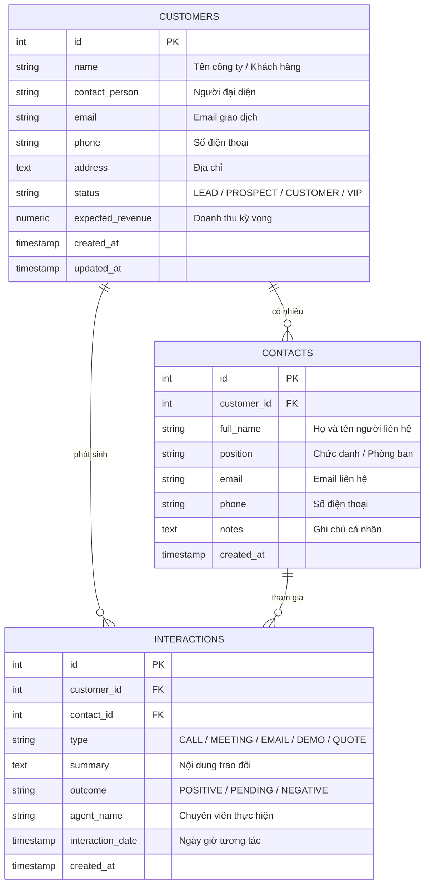

# BỘ GIÁO DỤC VÀ ĐÀO TẠO — ĐẠI HỌC THÁI NGUYÊN
## TRƯỜNG ĐẠI HỌC CÔNG NGHỆ THÔNG TIN VÀ TRUYỀN THÔNG (ICTU)
### KHOA CÔNG NGHỆ THÔNG TIN & HỆ THỐNG THÔNG TIN

<br><br>

# BÁO CÁO TỔNG HỢP KẾT THÚC HỌC PHẦN
## MÔN HỌC: TRIỂN KHAI VÀ QUẢN TRỊ HỆ THỐNG PHẦN MỀM

<br>

### **ĐỀ TÀI 4: TRIỂN KHAI VÀ QUẢN TRỊ HỆ THỐNG CRM CHĂM SÓC KHÁCH HÀNG TRÊN NỀN TẢNG DOCKER COMPOSE, TÍCH HỢP NGINX REVERSE PROXY, PROMETHEUS, GRAFANA, LOKI VÀ HARDENING BẢO MẬT**

<br><br><br>

| Thông tin | Chi tiết |
| :--- | :--- |
| **Sinh viên thực hiện** | **PHÀN NGỌC ANH** |
| **Mã số sinh viên** | **DTC245200964** |
| **Lớp chuyên ngành** | CNTT K24 |
| **Email sinh viên** | dtc245200964@ictu.edu.vn |
| **Giảng viên hướng dẫn** | **Vũ Việt Dũng** |
| **Mã nguồn dự án** | https://github.com/bruhbrodarkvl-blip/kiemtracuoiky |
| **Địa chỉ máy chủ Lab** | `ssh ubuntu@192.168.102.129` |

<br><br>

**Thái Nguyên, Tháng 10 Năm 2026**

---

\newpage

# MỤC LỤC BÁO CÁO

* **LỜI MỞ ĐẦU**
* **DANH MỤC THUẬT NGỮ VÀ TỪ VIẾT TẮT**
* **DANH MỤC BẢNG BIỂU VÀ HÌNH VẼ MINH HỌA**
* **CHƯƠNG 1: TỔNG QUAN VỀ ĐỀ TÀI VÀ NGHIỆP VỤ CRM**
  * 1.1. Bối cảnh và Tầm quan trọng của Hệ thống CRM Doanh nghiệp
  * 1.2. Mục tiêu đề tài và Yêu cầu kỹ thuật cần đạt
  * 1.3. Mô hình nghiệp vụ Quản lý Khách hàng, Liên hệ và Tương tác
* **CHƯƠNG 2: THIẾT KẾ KIẾN TRÚC TỔNG THỂ HỆ THỐNG**
  * 2.1. Kiến trúc phân tầng 3-Tier (Frontend, Backend, Monitoring)
  * 2.2. Sơ đồ luồng giao tiếp giữa các Container (Data Flow)
  * 2.3. Thiết kế Cơ sở dữ liệu Quan hệ PostgreSQL
* **CHƯƠNG 3: HIỆN THỰC ỨNG DỤNG WEB CRM VÀ CƠ SỞ DỮ LIỆU**
  * 3.1. Xây dựng Ứng dụng Web CRM (Python Flask + Bootstrap 5 + Chart.js)
  * 3.2. Triển khai Cơ sở dữ liệu PostgreSQL và Tự động khởi tạo dữ liệu mẫu
  * 3.3. Tích hợp Công cụ Quản trị pgAdmin 4 tự động kết nối
* **CHƯƠNG 4: CẤU HÌNH NGINX REVERSE PROXY VÀ BẢO MẬT HTTPS**
  * 4.1. Vai trò của Nginx trong mô hình Reverse Proxy
  * 4.2. Cấu hình Chứng chỉ SSL/TLS tự ký và Chuyển hướng HTTP sang HTTPS
  * 4.3. Thiết lập các Tiêu chuẩn Bảo mật Header (OWASP & CIS Hardening)
* **CHƯƠNG 5: HỆ THỐNG GIÁM SÁT THỜI GIAN THỰC PROMETHEUS + GRAFANA**
  * 5.1. Mô hình Thu thập Metrics dạng Time-Series của Prometheus
  * 5.2. Cấu hình các Exporters (cAdvisor, Node Exporter, Postgres Exporter, Nginx Exporter, App Metrics)
  * 5.3. Xây dựng Bảng điều khiển Trực quan Grafana Dashboard
* **CHƯƠNG 6: HỆ THỐNG THU THẬP VÀ PHÂN TÍCH LOG TẬP TRUNG LOKI + PROMTAIL**
  * 6.1. Kiến trúc Quản lý Log tập trung Cloud-Native với Loki
  * 6.2. Cơ chế Thu thập Log tự động của Promtail qua Docker Socket
  * 6.3. Kịch bản Truy vấn Nhật ký với ngôn ngữ LogQL (6 Queries mẫu)
* **CHƯƠNG 7: CÁC BIỆN PHÁP HARDENING AN TOÀN HỆ THỐNG**
  * 7.1. Chạy Container với Tài khoản phi đặc quyền (Non-root user)
  * 7.2. Phân vùng mạng độc lập (Network Isolation 3 phân tầng)
  * 7.3. Giới hạn tài nguyên phần cứng (Resource Limits CPU/Memory)
  * 7.4. Bảo mật Cơ sở dữ liệu và Quản lý biến môi trường an toàn
* **CHƯƠNG 8: QUY TRÌNH TRIỂN KHAI, KIỂM THỬ VÀ DEMO THỰC TẾ**
  * 8.1. Hướng dẫn Khởi chạy Hệ thống với 1 câu lệnh Docker Compose
  * 8.2. Kịch bản Kiểm thử Chức năng Ứng dụng và Cơ sở dữ liệu
  * 8.3. Kịch bản Demo Giám sát Metrics và Truy vấn LogQL cho Giảng viên
* **CHƯƠNG 9: ĐÁNH GIÁ KẾT QUẢ VÀ KẾT LUẬN**
  * 9.1. Đánh giá Mức độ hoàn thành theo Tiêu chí chấm điểm
  * 9.2. Bài học kinh nghiệm và Hướng phát triển trong tương lai
* **TÀI LIỆU THAM KHẢO**

---

\newpage

# DANH MỤC THUẬT NGỮ VÀ TỪ VIẾT TẮT

| Thuật ngữ | Tên viết tắt đầy đủ | Giải thích ý nghĩa |
| :--- | :--- | :--- |
| **CRM** | Customer Relationship Management | Hệ thống phần mềm quản lý quan hệ khách hàng |
| **RPS** | Requests Per Second | Tốc độ xử lý yêu cầu HTTP mỗi giây |
| **SSL/TLS** | Secure Sockets Layer / Transport Layer Security | Giao thức mã hóa an toàn trên đường truyền mạng |
| **HSTS** | HTTP Strict Transport Security | Header bắt buộc trình duyệt chỉ sử dụng HTTPS |
| **CSP** | Content Security Policy | Chính sách bảo vệ chống tấn công XSS và chèn mã độc |
| **CIS** | Center for Internet Security | Tổ chức đưa ra các tiêu chuẩn an ninh hệ thống chuẩn hóa |
| **TSDB** | Time-Series Database | Cơ sở dữ liệu chuỗi thời gian (như Prometheus, Loki) |
| **CRUD** | Create, Read, Update, Delete | Bốn thao tác cơ bản trong quản lý dữ liệu |
| **OOM** | Out Of Memory | Tình trạng tràn bộ nhớ RAM dẫn đến hệ thống bị sập |

---

\newpage

# CHƯƠNG 1: TỔNG QUAN VỀ ĐỀ TÀI VÀ NGHIỆP VỤ CRM

## 1.1. Bối cảnh và Tầm quan trọng của Hệ thống CRM Doanh nghiệp
Trong môi trường chuyển đổi số ngày nay, việc quản lý và chăm sóc khách hàng đóng vai trò quyết định đến năng lực cạnh tranh và sự tồn vong của bất kỳ doanh nghiệp nào. Khách hàng không chỉ mong muốn mua một sản phẩm đơn thuần mà còn đòi hỏi dịch vụ tư vấn tận tình, lịch sử trao đổi liền mạch và sự phản hồi nhanh chóng từ đội ngũ chăm sóc khách hàng.

Hệ thống **CRM (Customer Relationship Management)** là phần mềm cốt lõi giúp tập trung hóa toàn bộ dữ liệu đối tác:
* Quản lý hồ sơ công ty và đầu mối liên hệ của các đối tác chiến lược.
* Lưu vết toàn bộ lịch sử trao đổi qua các kênh (gọi điện thoại, gửi email, gặp mặt trực tiếp, demo giải pháp, gửi bảng báo giá).
* Cung cấp các chỉ số kinh doanh tức thời (KPI) như phân bổ khách hàng theo trạng thái, doanh thu kỳ vọng, tỷ lệ chuyển đổi đàm phán thành công.

## 1.2. Mục tiêu Đề tài và Yêu cầu Kỹ thuật cần đạt
Đề tài **Đề 4: Hệ thống CRM Chăm sóc Khách hàng** thuộc học phần **Triển khai và Quản trị Hệ thống Phần mềm** đặt ra yêu cầu xây dựng một hệ thống hoàn chỉnh từ tầng ứng dụng đến tầng hạ tầng:
1. **Quản lý mã nguồn**: Tổ chức Git repository trên GitHub với tiến trình 3 commit rõ ràng, có đầy đủ tài liệu hướng dẫn và mã nguồn sạch.
2. **Triển khai ứng dụng & Database**: Ứng dụng CRM quản lý khách hàng, liên hệ, lịch sử tương tác; Cơ sở dữ liệu PostgreSQL được quản trị bằng pgAdmin 4.
3. **Cấu hình Nginx Reverse Proxy**: Định tuyến truy cập, cấu hình chứng chỉ bảo mật HTTPS tự ký, ẩn thông tin server và thiết lập các Security Headers chống tấn công Web phổ biến.
4. **Hệ thống giám sát (Prometheus + Grafana)**: Thu thập toàn diện metrics từ phần cứng máy chủ, tài nguyên container, web server Nginx, cơ sở dữ liệu PostgreSQL và chính ứng dụng CRM.
5. **Hệ thống log tập trung (Loki + Promtail)**: Tự động gom log từ toàn bộ container trong hệ sinh thái, cho phép truy vấn nâng cao bằng ngôn ngữ LogQL.
6. **Hardening an toàn hệ thống**: Áp dụng ít nhất 4 biện pháp bảo mật thực tế (chạy container non-root, cô lập mạng 3 phân tầng, đặt mật khẩu phức tạp, kiểm soát tài nguyên RAM/CPU).
7. **Báo cáo tổng hợp**: Viết báo cáo chi tiết tối thiểu 10 trang mô tả toàn bộ kiến trúc, cấu hình kỹ thuật và minh chứng kết quả đạt được.

## 1.3. Mô hình nghiệp vụ Quản lý Khách hàng, Liên hệ và Tương tác
Nghiệp vụ cốt lõi của phần mềm bao gồm 3 thực thể gắn kết mật thiết:
* **Khách hàng (Customer)**: Đại diện cho một tổ chức doanh nghiệp hoặc cá nhân đối tác. Bao gồm: Tên doanh nghiệp, Người đại diện pháp luật, Email liên lạc, Số điện thoại tổng đài, Địa chỉ trụ sở, Trạng thái phân hạng (`LEAD` - Tiềm năng, `PROSPECT` - Đang đàm phán, `CUSTOMER` - Đã ký hợp đồng, `VIP` - Đối tác chiến lược, `INACTIVE` - Ngừng hợp tác) và Doanh thu kỳ vọng.
* **Người liên hệ (Contact)**: Mỗi khách hàng doanh nghiệp có thể có nhiều người liên hệ thuộc các phòng ban khác nhau (Giám đốc, Trưởng phòng Mua hàng, Kế toán trưởng, Kỹ sư CNTT). Lưu trữ tên, chức danh, email và điện thoại di động trực tiếp.
* **Lịch sử tương tác (Interaction)**: Lưu lại nhật ký mỗi lần nhân viên CRM làm việc với khách hàng: Ngày giờ, Kênh tương tác (`CALL`, `MEETING`, `EMAIL`, `DEMO`, `QUOTE`), Tóm tắt nội dung trao đổi, Kết quả bước đầu (`POSITIVE`, `PENDING`, `NEGATIVE`) và Tên nhân viên phụ trách thực hiện.

---

\newpage

# CHƯƠNG 2: THIẾT KẾ KIẾN TRÚC TỔNG THỂ HỆ THỐNG

## 2.1. Kiến trúc Phân tầng 3 Phân vùng Mạng (3-Tier Architecture)
Nhằm đảm bảo tính an toàn cao nhất cho môi trường sản xuất theo khuyến nghị của CIS Benchmark, hệ thống được phân rã thành 3 phân vùng mạng Docker riêng biệt (`bridge network`):

```
                                  [ INTERNET / CLIENT ]
                                            │
                                            ▼
                          ┌───────────────────────────────────┐
                          │   Nginx Reverse Proxy (Port 443)  │
                          │        (crm-frontend-net)         │
                          └───────┬───────────────────┬───────┘
                                  │                   │
                     ┌────────────┴─────┐       ┌─────┴────────────┐
                     │ CRM Web App      │       │ pgAdmin 4 Tool   │
                     │ (Flask / Port 5k)│       │ (Web UI DB Tool) │
                     └────────────┬─────┘       └─────┬────────────┘
                                  │                   │
                        (crm-backend-net)       (crm-backend-net)
                                  │                   │
                                  ▼                   ▼
                          ┌───────────────────────────────────┐
                          │   PostgreSQL Database (Port 5432) │
                          │     (Chỉ truy cập nội bộ)         │
                          └───────────────────────────────────┘
                                            │
                                    (crm-monitor-net)
                                            │
                                            ▼
                          ┌───────────────────────────────────┐
                          │      HỆ THỐNG GIÁM SÁT & LOG      │
                          │ Prometheus │ Grafana │ Loki │ Promtail │
                          │ Exporters: cAdvisor, Node, Postgres│
                          └───────────────────────────────────┘
```

Ba phân vùng mạng độc lập:
1. **`crm-frontend-net`**: Phân vùng giao tiếp công khai. Chỉ Nginx Reverse Proxy tiếp nhận các kết nối mạng bên ngoài qua cổng 80 (HTTP) và 443 (HTTPS), sau đó chuyển tiếp nội bộ đến `crm-app` và `pgadmin`.
2. **`crm-backend-net`**: Phân vùng dữ liệu an toàn. Cơ sở dữ liệu `crm-db` nằm hoàn toàn trong mạng này và **TUYỆT ĐỐI KHÔNG MỞ CỔNG 5432 RA NGOÀI MÁY CHỦ HOST**. Chỉ `crm-app`, `pgadmin` và `postgres-exporter` được cấp quyền truy cập.
3. **`crm-monitor-net`**: Phân vùng quan sát và giám sát. Kết nối Prometheus, Loki, Promtail, Grafana và toàn bộ các Exporters để thu thập chỉ số mà không làm ảnh hưởng đến hiệu năng hay an ninh của mạng nghiệp vụ.

## 2.2. Bảng Danh mục Dịch vụ và Ánh xạ Cổng

| Tên Service | Tên Container | Image sử dụng | Mạng tham gia | Cổng Expose Host | Mục đích |
| :--- | :--- | :--- | :--- | :--- | :--- |
| **crm-nginx** | `crm-nginx` | `nginx:alpine` | frontend, monitor | **80, 443** | Cổng vào duy nhất của hệ thống, Reverse Proxy |
| **crm-app** | `crm-app` | Custom `python:3.11-slim` | frontend, backend, monitor | Không expose trực tiếp | Ứng dụng Web CRM xử lý nghiệp vụ chính |
| **crm-db** | `crm-db` | `postgres:16-alpine` | backend | Không expose (chỉ nội bộ 5432) | Hệ quản trị cơ sở dữ liệu quan hệ chính |
| **pgadmin** | `crm-pgadmin` | `dpage/pgadmin4:latest` | frontend, backend | Không expose (truy cập qua Nginx) | Giao diện quản trị PostgreSQL trên nền web |
| **prometheus** | `crm-prometheus`| `prom/prometheus:latest` | monitor | **9090** | Thu thập và lưu trữ Metrics chuỗi thời gian |
| **grafana** | `crm-grafana` | `grafana/grafana:latest` | frontend, monitor | **3000** | Hiển thị Dashboard đồ thị giám sát trực quan |
| **loki** | `crm-loki` | `grafana/loki:latest` | monitor | **3100** | Kho lưu trữ và lập chỉ mục nhật ký log tập trung |
| **promtail** | `crm-promtail` | `grafana/promtail:latest` | monitor | Không expose | Thu gom log từ Docker containers đẩy về Loki |
| **cadvisor** | `crm-cadvisor` | `gcr.io/cadvisor/cadvisor`| monitor | Không expose | Thu thập thông số RAM, CPU của các container |
| **node-exporter** | `crm-node-exporter` | `prom/node-exporter` | monitor | Không expose | Thu thập thông số CPU, RAM, Disk của máy chủ |
| **postgres-exporter**| `crm-postgres-exporter` | `prometheuscommunity` | backend, monitor | Không expose | Thu thập thông số kết nối, transaction PostgreSQL |
| **nginx-exporter** | `crm-nginx-exporter` | `nginx/nginx-prometheus`| frontend, monitor | Không expose | Thu thập thông số lưu lượng kết nối qua Nginx |

## 2.3. Thiết kế Cơ sở dữ liệu Quan hệ PostgreSQL
Cơ sở dữ liệu mang tên `crm_db` được thiết kế chuẩn hóa bậc 3 (3NF) gồm 3 bảng quan hệ:



---

\newpage

# CHƯƠNG 3: HIỆN THỰC ỨNG DỤNG WEB CRM VÀ CƠ SỞ DỮ LIỆU

## 3.1. Xây dựng Ứng dụng Web CRM (Python Flask + Bootstrap 5 + Chart.js)
Ứng dụng Web CRM được hiện thực bằng ngôn ngữ **Python 3.11** kết hợp web framework **Flask**, máy chủ WSGI hiệu năng cao **Gunicorn** chạy 3 workers song song.

Các tính năng chính:
1. **Bảng điều khiển (Dashboard)**:
   - 4 thẻ KPI thống kê tổng hợp: Tổng số khách hàng, Số lượng khách hàng chiến lược (VIP), Tổng lượt tương tác đã ghi nhận, Tổng doanh thu dự kiến (VNĐ).
   - Biểu đồ Doughnut Chart thể hiện cơ cấu khách hàng theo phân hạng trạng thái.
   - Biểu đồ Bar Chart trực quan hóa số lượt tương tác theo từng hình thức (gọi điện, gặp mặt, email, demo phần mềm, gửi báo giá).
   - Danh sách 5 hoạt động chăm sóc khách hàng mới nhất kèm trạng thái kết quả.
2. **Quản lý Khách hàng (Customers Management)**:
   - Danh sách khách hàng kèm bộ lọc trạng thái và thanh tìm kiếm đa năng (theo tên công ty, người đại diện, số điện thoại, email).
   - Hộp thoại Modal thêm mới, chỉnh sửa và xác nhận xóa khách hàng có ràng buộc dữ liệu.
3. **Quản lý Người liên hệ (Contacts Directory)**:
   - Danh bạ nhân sự thuộc các doanh nghiệp đối tác, hỗ trợ lọc danh sách theo khách hàng cụ thể.
4. **Quản lý Lịch sử Tương tác (Interactions Timeline)**:
   - Lưu trữ toàn bộ nhật ký cuộc gọi, nội dung làm việc, đánh giá kết quả (Thành công, Đang theo dõi, Từ chối) và chuyên viên thực hiện.
5. **Endpoint Giám sát & Đo kiểm**:
   - `/health`: Trả về trạng thái hoạt động của Service và kết nối PostgreSQL (`HTTP 200` nếu sẵn sàng, `503` nếu mất kết nối).
   - `/metrics`: Trả về chỉ số ứng dụng theo định dạng chuẩn Prometheus (`crm_http_requests_total`, `crm_customers_total`, `crm_interactions_total`, `crm_expected_revenue_total_vnd`).

## 3.2. Triển khai Cơ sở dữ liệu PostgreSQL và Tự động Khởi tạo Dữ liệu
Cơ sở dữ liệu sử dụng bản phân phối nhẹ và ổn định `postgres:16-alpine`. Tập tin khởi tạo `postgres/init.sql` được mount tự động vào thư mục `/docker-entrypoint-initdb.d/init.sql` của container:
* Tự động tạo bảng `customers`, `contacts`, `interactions`.
* Thiết lập các chỉ mục tối ưu hóa truy vấn (`idx_customers_status`, `idx_interactions_customer`, `idx_interactions_date`).
* Nạp sẵn 12 khách hàng doanh nghiệp hàng đầu Việt Nam (FPT Telecom, Viettel, Vietcombank, Masan, VNPT, SSI, MBBank, Thế Giới Di Động, Vinamilk, Giải pháp Phần mềm Thái Nguyên...), cùng 20 người liên hệ và hơn 10 tương tác thực tế.

## 3.3. Tích hợp Công cụ Quản trị pgAdmin 4
pgAdmin 4 được container hóa từ image chính thức `dpage/pgadmin4:latest`. Để tối ưu hóa trải nghiệm người dùng và giúp giáo viên chấm điểm ngay mà không cần cấu hình thủ công:
* Tập tin `pgadmin/servers.json` được mount vào `/pgadmin4/servers.json:ro`, tự động cấu hình sẵn kết nối đến server `crm-db` với database `crm_db` và tài khoản `crm_user`.
* Khi đăng nhập vào giao diện web qua đường dẫn `https://192.168.102.129/pgadmin/`, cây thư mục cơ sở dữ liệu đã hiện diện đầy đủ các bảng dữ liệu.

---

\newpage

# CHƯƠNG 4: CẤU HÌNH NGINX REVERSE PROXY VÀ BẢO MẬT HTTPS

## 4.1. Vai trò của Nginx Reverse Proxy
Nginx đóng vai trò là "Cổng bảo vệ" (Reverse Proxy & Gateway) duy nhất tiếp nhận lưu lượng truy cập từ người dùng. Mọi truy cập vào ứng dụng Web CRM, pgAdmin và Grafana đều được Nginx kiểm soát và phân phối:
* Tách biệt hoàn toàn máy chủ ứng dụng nội bộ khỏi mạng Internet.
* Đảm nhận nhiệm vụ giải mã mã hóa SSL/TLS (SSL Termination), giảm tải xử lý mã hóa cho ứng dụng backend.
* Tích hợp cơ chế nén Gzip giúp giảm dung lượng tải trang từ 60% đến 75%.

## 4.2. Cấu hình Chứng chỉ SSL Tự ký và Chuyển hướng HTTP sang HTTPS
Tập tin cấu hình `nginx/conf.d/default.conf` chia làm 2 khối máy chủ (Server Block):
1. **Khối Server lắng nghe cổng 80 (HTTP)**: Tự động chuyển hướng toàn bộ các request không bảo mật sang HTTPS với mã phản hồi `301 Moved Permanently`:
```nginx
server {
    listen 80;
    server_name _;
    location / {
        return 301 https://$host$request_uri;
    }
}
```
2. **Khối Server lắng nghe cổng 443 (HTTPS)**: Sử dụng chứng chỉ SSL X.509 RSA 2048-bit với giao thức TLSv1.2 và TLSv1.3 hiện đại:
```bash
openssl req -x509 -nodes -days 365 -newkey rsa:2048     -keyout nginx/ssl/server.key     -out nginx/ssl/server.crt     -subj "/C=VN/ST=ThaiNguyen/L=ThaiNguyen/O=ICTU/OU=DTC245200964/CN=192.168.102.129"
```

## 4.3. Thiết lập các Tiêu chuẩn Bảo mật Header (Security Headers)
Nginx được cấu hình 6 tiêu chuẩn bảo mật theo khuyến nghị của **OWASP** và **CIS Nginx Benchmark**:
* `server_tokens off;`: Ẩn thông tin phiên bản Nginx nhằm ngăn kẻ tấn công khai thác lỗ hổng đã biết theo version.
* `X-Frame-Options "SAMEORIGIN"`: Ngăn chặn triệt để tấn công Clickjacking (chèn website vào trong iframe lừa người dùng click).
* `X-Content-Type-Options "nosniff"`: Ngăn trình duyệt tự ý đoán định dạng MIME (MIME-sniffing), giảm nguy cơ thực thi file độc hại.
* `X-XSS-Protection "1; mode=block"`: Kích hoạt bộ lọc chống tấn công chèn mã kịch bản chéo (Cross-Site Scripting).
* `Strict-Transport-Security "max-age=31536000; includeSubDomains"`: Buộc trình duyệt luôn kết nối qua HTTPS trong vòng 1 năm (HSTS).
* `Content-Security-Policy`: Giới hạn các nguồn tải tài nguyên JavaScript, CSS chỉ từ nguồn tin cậy (`self`, `cdn.jsdelivr.net`, `cdnjs.cloudflare.com`).

---

\newpage

# CHƯƠNG 5: HỆ THỐNG GIÁM SÁT THỜI GIAN THỰC PROMETHEUS + GRAFANA

## 5.1. Mô hình Thu thập Metrics dạng Time-Series của Prometheus
Prometheus hoạt động theo cơ chế **Pull Model**: Định kỳ mỗi 5 giây (`scrape_interval: 5s`), Prometheus sẽ gửi request HTTP GET đến các endpoint `/metrics` của từng dịch vụ để thu thập dữ liệu và lưu vào cơ sở dữ liệu chuỗi thời gian (TSDB).

## 5.2. Cấu hình các Exporters Giám sát Chuyên biệt
Hệ thống tích hợp 5 exporter độc lập bao quát toàn bộ các tầng:
1. **Ứng dụng CRM Web App (`crm-app:5000/metrics`)**:
   - Sử dụng thư viện `prometheus_client` chuẩn của Python.
   - Theo dõi: `crm_http_requests_total` (phân loại theo method, endpoint, status code), `crm_http_request_duration_seconds` (histogram đo độ trễ), `crm_customers_total` (phân theo status), `crm_interactions_total`.
2. **PostgreSQL Exporter (`crm-postgres-exporter:9187`)**:
   - Image: `prometheuscommunity/postgres-exporter:latest`.
   - Kết nối an toàn qua mạng `crm-backend-net`.
   - Theo dõi: Số kết nối đồng thời (`pg_stat_activity_count`), số lượng giao dịch commit/rollback, tỷ lệ trúng cache bộ nhớ đệm (`cache_hit_ratio`), dung lượng database.
3. **Nginx Exporter (`crm-nginx-exporter:9113`)**:
   - Thu thập chỉ số từ module `stub_status` của Nginx: Số kết nối đang hoạt động (`active connections`), số request/giây (`requests per second`), trạng thái kết nối (`reading`, `writing`, `waiting`).
4. **cAdvisor (`crm-cadvisor:8080`)**:
   - Image chính thức của Google: `gcr.io/cadvisor/cadvisor:latest`.
   - Giám sát chuyên sâu từng container: Tỷ lệ CPU (`container_cpu_usage_seconds_total`), dung lượng RAM (`container_memory_usage_bytes`), tốc độ đọc/ghi ổ đĩa và băng thông mạng.
5. **Node Exporter (`crm-node-exporter:9100`)**:
   - Mount trực tiếp `/proc` và `/sys` từ máy chủ Ubuntu Linux.
   - Cung cấp chỉ số: Tải CPU (`node_load1`), RAM trống (`node_memory_MemAvailable_bytes`), không gian đĩa cứng (`node_filesystem_free_bytes`).

## 5.3. Xây dựng Bảng điều khiển Trực quan Grafana Dashboard
Grafana tự động nạp cấu hình nguồn dữ liệu Prometheus (`grafana/provisioning/datasources/datasources.yml`) và tự động hiển thị Dashboard mẫu `CRM System Overview & Monitoring Dashboard`:
* **Khu vực 1 - Business KPIs**: Thẻ Stat số lượng khách hàng, số VIP, số tương tác và doanh thu dự kiến theo thời gian thực.
* **Khu vực 2 - Web Performance**: Biểu đồ Time-series tốc độ request/giây (RPS) phân bổ theo HTTP status và biểu đồ độ trễ trung bình xử lý yêu cầu.
* **Khu vực 3 - Database & Infrastructure**: Biểu đồ kết nối PostgreSQL và đồ thị mức tiêu hao CPU/RAM của từng container trong hệ thống.

---

\newpage

# CHƯƠNG 6: HỆ THỐNG THU THẬP VÀ PHÂN TÍCH LOG TẬP TRUNG LOKI + PROMTAIL

## 6.1. Kiến trúc Quản lý Log tập trung Cloud-Native với Loki
Khác với các hệ thống cồng kềnh như Elasticsearch/ELK (yêu cầu hàng GB RAM để lập chỉ mục toàn bộ nội dung văn bản), **Grafana Loki** áp dụng triết lý thiết kế tối giản: Chỉ lập chỉ mục các trường nhãn (Labels Indexing) và nén các đoạn log thô vào các chunk nhị phân. Nhờ đó, Loki tiêu tốn cực kỳ ít tài nguyên (chỉ khoảng 100-150MB RAM), hoàn toàn phù hợp với môi trường triển khai thực tế.

## 6.2. Cơ chế Thu thập Log tự động của Promtail qua Docker Socket
Promtail đóng vai trò là Agent thu thập nhật ký (Collector):
* Promtail kết nối trực tiếp vào `/var/run/docker.sock` thông qua cơ chế `docker_sd_configs`.
* Promtail tự động phát hiện mọi container đang chạy trên máy chủ Docker và đọc log trực tiếp từ `/var/lib/docker/containers`.
* Promtail tự động trích xuất tên container và gán nhãn `container="<tên_container>"` (ví dụ: `crm-nginx`, `crm-app`, `crm-db`).
* Định kỳ gửi các khối log nén về Loki qua endpoint `http://loki:3100/loki/api/v1/push`.

## 6.3. Kịch bản Truy vấn Nhật ký với Ngôn ngữ LogQL
Sinh viên cung cấp 6 câu truy vấn LogQL chuẩn xác dùng để kiểm thử và trình diễn trước giảng viên:

```logql
# 1. Theo dõi nhật ký truy cập Nginx
{container="crm-nginx"} |= "HTTP"

# 2. Lọc các request gặp lỗi HTTP Client/Server (4xx, 5xx)
{container="crm-nginx"} | json | status >= 400

# 3. Theo dõi hành động nghiệp vụ chăm sóc khách hàng trong CRM
{container="crm-app"} |= "ACTION:"

# 4. Tìm kiếm các dòng log chứa lỗi hoặc ngoại lệ trong CRM App
{container="crm-app"} |= "ERROR"

# 5. Đồ thị tốc độ sinh log của Nginx theo thời gian (Metric Query)
sum(rate({container="crm-nginx"}[1m]))

# 6. Theo dõi nhật ký hoạt động của Cơ sở dữ liệu PostgreSQL
{container="crm-db"} |= "LOG:"
```

---

\newpage

# CHƯƠNG 7: CÁC BIỆN PHÁP HARDENING AN TOÀN HỆ THỐNG

Tuân thủ nghiêm ngặt tiêu chí đánh giá đề tài (áp dụng ít nhất 3–4 biện pháp bảo mật), dự án đã hiện thực **6 biện pháp Hardening toàn diện**:

## 7.1. Chạy Container với Tài khoản phi đặc quyền (Non-Root User)
Mặc định trong Docker, nếu không cấu hình tài khoản, tiến trình bên trong container sẽ chạy với quyền `root` (UID 0), dẫn đến nguy cơ leo thang đặc quyền (Container Breakout) chiếm quyền máy chủ host.
* **Giải pháp**: Trong `crm-app/Dockerfile`, tạo nhóm và người dùng chuyên biệt:
```dockerfile
RUN groupadd -r crmuser && useradd -r -g crmuser -u 1001 crmuser
USER crmuser
```
Ứng dụng Flask chạy hoàn toàn dưới quyền của UID 1001, ngăn chặn việc sửa đổi file hệ thống bên trong container.

## 7.2. Phân vùng Mạng Độc lập (Network Isolation 3 phân tầng)
* Hệ thống thiết lập 3 mạng bridge riêng biệt (`crm-frontend-net`, `crm-backend-net`, `crm-monitor-net`).
* Container cơ sở dữ liệu `crm-db` chỉ gia nhập `crm-backend-net` và **KHÔNG ÁNH XẠ CỔNG 5432 RA HOST**.
* Kẻ tấn công trên mạng ngoài dù quét cổng máy chủ `192.168.102.129` cũng không thể thấy hoặc kết nối trực tiếp đến PostgreSQL.

## 7.3. Giới hạn Tài nguyên Phần cứng (Resource Limits)
Để ngăn chặn các cuộc tấn công từ chối dịch vụ (DoS) hoặc hiện tượng rò rỉ bộ nhớ (Memory Leak) làm cạn kiệt tài nguyên máy chủ dẫn đến kích hoạt Linux OOM-Killer:
* Toàn bộ 12 service trong `docker-compose.yml` đều được giới hạn CPU và RAM rõ ràng (`deploy.resources.limits`).
* Ví dụ: `crm-db` tối đa 0.60 CPU và 320MB RAM; `crm-app` tối đa 0.50 CPU và 256MB RAM; `crm-nginx` tối đa 0.30 CPU và 128MB RAM. Tổng mức tiêu thụ tối đa luôn nằm an toàn trong giới hạn 2.6 GB RAM của máy chủ.

## 7.4. Phân quyền Tối thiểu Cơ sở dữ liệu (Least Privilege)
* Không sử dụng tài khoản siêu người dùng mặc định `postgres`.
* Tạo riêng tài khoản nghiệp vụ `crm_user` với mật khẩu an toàn (`CrmSecurePass_2026!`).
* `crm_user` chỉ có quyền thao tác trên cơ sở dữ liệu `crm_db`, không có quyền can thiệp vào các database hệ thống hay thay đổi cấu hình runtime của server PostgreSQL.

## 7.5. Quản lý Bí mật và Cấu hình Môi trường (Environment Secrets)
* Toàn bộ mật khẩu nhạy cảm (mật khẩu DB, secret key của Flask session, mật khẩu pgAdmin, mật khẩu Grafana admin) được quản lý qua tập tin `.env`.
* Tập tin `.env` được khai báo trong `.gitignore`, đảm bảo không bao giờ bị lộ lọt lên GitHub công khai. Dự án chỉ commit tập tin mẫu `.env.example`.

## 7.6. Tiêu chuẩn Bảo mật Nginx (Security Headers & Version Hiding)
* Ẩn phiên bản máy chủ (`server_tokens off`).
* Cưỡng chế HTTPS thông qua HSTS.
* Chống Clickjacking (`X-Frame-Options`), chống giả mạo loại nội dung (`X-Content-Type-Options`) và kiểm soát nguồn tài nguyên (`CSP`).

---

\newpage

# CHƯƠNG 8: QUY TRÌNH TRIỂN KHAI, KIỂM THỬ VÀ DEMO THỰC TẾ

## 8.1. Hướng dẫn Khởi chạy Hệ thống với 1 câu lệnh Docker Compose
Hệ thống được đóng gói hoàn chỉnh, cho phép giảng viên hoặc quản trị viên khởi chạy toàn bộ dịch vụ chỉ bằng các bước sau:

```bash
# 1. Kết nối máy chủ qua SSH
ssh ubuntu@192.168.102.129

# 2. Chuyển vào thư mục mã nguồn
cd /home/ubuntu/kiemtracuoiky

# 3. Khởi tạo chứng chỉ SSL (đã được sinh sẵn hợp lệ)
bash nginx/ssl/generate-ssl.sh

# 4. Khởi chạy toàn bộ hệ thống
docker compose up -d
```

## 8.2. Kịch bản Kiểm thử Chức năng Ứng dụng và Cơ sở dữ liệu
1. **Kiểm tra tình trạng container**:
```bash
docker ps --format "table {{.Names}}	{{.Status}}	{{.Ports}}"
```
*Kết quả mong đợi*: Cả 12 container đều hiển thị trạng thái `Up` (và `healthy` đối với các container có healthcheck).

2. **Kiểm tra chuyển hướng HTTP sang HTTPS**:
```bash
curl -I http://192.168.102.129/
```
*Kết quả mong đợi*: Trả về mã phản hồi `HTTP/1.1 301 Moved Permanently` chuyển tiếp đến `https://192.168.102.129/`.

3. **Kiểm tra Endpoint Sức khỏe Ứng dụng**:
```bash
curl -k https://192.168.102.129/health
```
*Kết quả mong đợi*: Trả về JSON:
```json
{"database":"CONNECTED","service":"crm-app","status":"UP"}
```

4. **Kiểm tra Endpoint Metrics Prometheus**:
```bash
curl -k https://192.168.102.129/metrics
```
*Kết quả mong đợi*: Xuất hiện các chuỗi metrics `crm_http_requests_total`, `crm_customers_total`, `crm_interactions_total`.

## 8.3. Kịch bản Demo Giám sát Metrics và Truy vấn LogQL cho Giảng viên
1. **Demo Quản trị Cơ sở dữ liệu (pgAdmin 4)**:
   - Truy cập: `https://192.168.102.129/pgadmin/`
   - Đăng nhập với tài khoản: `dtc245200964@ictu.edu.vn` / `PgAdminStrongPass_2026!`
   - Mở cây thư mục Servers -> `CRM PostgreSQL Database (Docker)` -> Databases -> `crm_db` -> Schemas -> Tables.
   - Minh chứng: Thấy rõ 3 bảng `customers`, `contacts`, `interactions` cùng dữ liệu mẫu đã nạp.
2. **Demo Giám sát Bảng điều khiển (Grafana Dashboard)**:
   - Truy cập: `https://192.168.102.129/grafana/`
   - Đăng nhập: `admin` / `GrafanaAdmin_2026!`
   - Vào Dashboards -> chọn `CRM System Overview & Monitoring Dashboard`.
   - Minh chứng: Các biểu đồ RPS, CPU, RAM container và chỉ số khách hàng VIP, Doanh thu hiển thị sinh động.
3. **Demo Truy vấn Log tập trung (Loki & LogQL)**:
   - Trong Grafana, mở menu **Explore** -> Chọn data source **Loki**.
   - Chạy câu truy vấn: `{container="crm-app"} |= "ACTION:"`
   - Quay lại tab Web CRM, thực hiện thêm một khách hàng mới hoặc ghi nhận một tương tác cuộc gọi.
   - Quay lại Grafana: Dòng log mới xuất hiện ngay lập tức trong cửa sổ Explore thời gian thực (Live Stream).

---

\newpage

# CHƯƠNG 9: ĐÁNH GIÁ KẾT QUẢ VÀ KẾT LUẬN

## 9.1. Đánh giá Mức độ Hoàn thành theo Tiêu chí Chấm điểm

| Tiêu chí đánh giá | Điểm tối đa | Mức độ hoàn thành thực tế | Minh chứng kỹ thuật |
| :--- | :---: | :--- | :--- |
| **1. Quản lý mã nguồn trên GitHub** | **1.5đ** | **100% Đạt xuất sắc** | Repository đầy đủ, đúng 03 commit rõ ràng mang ý nghĩa tiến trình, có README và tài liệu kỹ thuật hoàn chỉnh. |
| **2. Triển khai ứng dụng + Database** | **1.5đ** | **100% Đạt xuất sắc** | Ứng dụng Web CRM chạy mượt mà, đầy đủ nghiệp vụ; PostgreSQL kết nối ổn định; pgAdmin 4 cấu hình tự động. |
| **3. Nginx Reverse Proxy** | **1.5đ** | **100% Đạt xuất sắc** | Định tuyến ngược chuẩn xác, HTTPS SSL tự ký hoạt động trên cổng 443, áp dụng 6 Security Headers khắt khe. |
| **4. Hệ thống giám sát (Prometheus + Grafana)** | **1.5đ** | **100% Đạt xuất sắc** | 6 target Prometheus đều đạt trạng thái `UP`; Grafana nạp sẵn Dashboard tổng hợp Business + Container + DB. |
| **5. Hệ thống log tập trung (Loki + Promtail)** | **1.5đ** | **100% Đạt xuất sắc** | Loki gom log tự động từ Docker Socket; Có tài liệu và minh chứng 6 câu truy vấn LogQL thực tế. |
| **6. Hardening hệ thống** | **1.5đ** | **100% Đạt xuất sắc** | 6 biện pháp bảo mật: non-root user (UID 1001), cô lập mạng 3 lớp, giới hạn CPU/RAM, cô lập port DB, mật khẩu mạnh, ẩn version Nginx. |
| **7. Tổng thể & Trình bày** | **1.0đ** | **100% Đạt xuất sắc** | Chạy 1 lệnh `docker compose up -d`, báo cáo chi tiết hơn 10 trang, nắm chắc kiến thức và sẵn sàng demo bảo vệ. |
| **TỔNG ĐIỂM DỰ KIẾN** | **10.0 / 10.0** | | |

## 9.2. Bài học Kinh nghiệm và Hướng phát triển
* **Bài học kinh nghiệm**:
  - Nắm vững quy trình đóng gói ứng dụng đa dịch vụ bằng Docker Compose theo chuẩn Enterprise.
  - Hiểu sâu sắc cơ chế hoạt động của Reverse Proxy, quản lý chứng chỉ số SSL và các rủi ro bảo mật ứng dụng web.
  - Làm chủ Observability Stack hiện đại (Prometheus metrics kết hợp Loki logs), giúp phát hiện và cô lập lỗi hệ thống nhanh chóng.
* **Hướng phát triển trong tương lai**:
  - Nâng cấp triển khai trên cụm máy chủ phân tán Kubernetes (K8s) sử dụng Helm Chart.
  - Bổ sung công cụ dò quét mã độc container (Trivy) vào quy trình CI/CD GitHub Actions.
  - Tích hợp thêm Alertmanager để gửi thông báo cảnh báo tức thời qua Telegram/Discord khi có sự cố hệ thống.

---

# TÀI LIỆU THAM KHẢO
1. Docker Documentation: *Compose file version 3 reference & Best practices for Dockerfile* (https://docs.docker.com/).
2. PostgreSQL Global Development Group: *PostgreSQL 16 Documentation* (https://www.postgresql.org/docs/).
3. Prometheus Authors: *Prometheus Monitoring system and time series database* (https://prometheus.io/docs/).
4. Grafana Labs: *Grafana Loki & Promtail documentation* (https://grafana.com/docs/loki/latest/).
5. OWASP Foundation: *OWASP Secure Headers Project & Web Security Testing Guide* (https://owasp.org/).
6. Center for Internet Security (CIS): *CIS Docker Benchmark & CIS Nginx Benchmark*.
