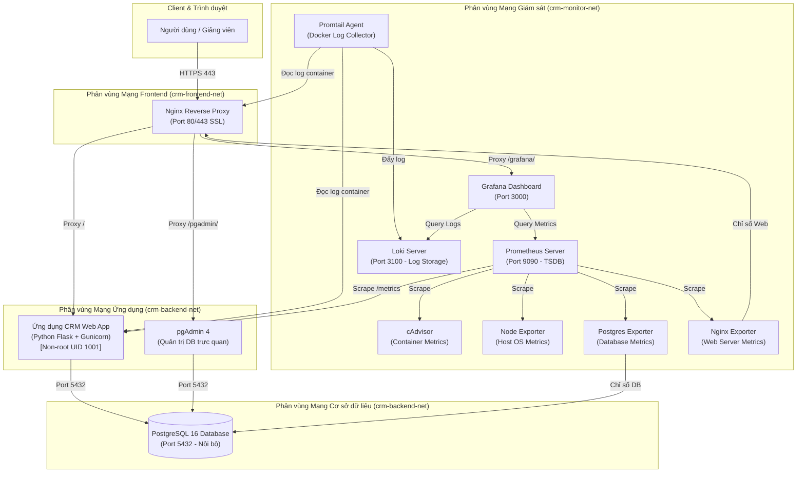

# HỆ THỐNG CRM CHĂM SÓC KHÁCH HÀNG (ĐỀ 4)
### MÔN HỌC: TRIỂN KHAI VÀ QUẢN TRỊ HỆ THỐNG PHẦN MỀM
**Trường Đại học Công nghệ Thông tin và Truyền thông - Đại học Thái Nguyên (ICTU)**

* **Giảng viên hướng dẫn**: Vũ Việt Dũng
* **Sinh viên thực hiện**: Phàn Ngọc Anh
* **Mã sinh viên**: DTC245200964
* **Lớp**: CNTT K24
* **Email**: dtc245200964@ictu.edu.vn
* **Repository**: https://github.com/bruhbrodarkvl-blip/kiemtracuoiky
* **Địa chỉ máy chủ Lab**: `ssh ubuntu@192.168.102.129` (mật khẩu: `ubuntu`)

---

## 1. Giới thiệu Đề tài
Dự án triển khai một hệ thống phần mềm **CRM Chăm sóc Khách hàng** toàn diện, đáp ứng đầy đủ yêu cầu quản lý khách hàng doanh nghiệp, người liên hệ phụ trách và lịch sử tương tác đa kênh. Toàn bộ hệ thống được container hóa bằng **Docker Compose**, bảo vệ bởi **Nginx Reverse Proxy (SSL/HTTPS)**, giám sát toàn diện qua **Prometheus + Grafana**, quản lý log tập trung với **Loki + Promtail**, và áp dụng các giải pháp **Hardening** bảo mật nghiêm ngặt.

---

## 2. Kiến trúc Hệ thống & Sơ đồ Triển khai (System Architecture)



---

## 3. Danh mục Dịch vụ và Thông tin Đăng nhập

| Dịch vụ | Địa chỉ truy cập | Tài khoản mặc định | Mục đích / Chức năng |
| :--- | :--- | :--- | :--- |
| **CRM Web App** | `https://192.168.102.129` | Không yêu cầu đăng nhập | Giao diện CRM Quản lý Khách hàng, Liên hệ, Tương tác |
| **pgAdmin 4** | `https://192.168.102.129/pgadmin/` | `dtc245200964@ictu.edu.vn`<br>`PgAdminStrongPass_2026!` | Quản trị CSDL PostgreSQL trực quan (tự động kết nối) |
| **Grafana** | `https://192.168.102.129/grafana/` | `admin`<br>`GrafanaAdmin_2026!` | Bảng điều khiển Giám sát Đồ họa & Khám phá Log |
| **Prometheus** | `http://192.168.102.129:9090` | Không yêu cầu | Máy chủ thu thập Metrics và kiểm tra trạng thái Targets |
| **App Health** | `https://192.168.102.129/health` | — | Endpoint kiểm tra sức khỏe ứng dụng và kết nối DB |
| **App Metrics** | `https://192.168.102.129/metrics` | — | Endpoint cung cấp chỉ số nghiệp vụ chuẩn Prometheus |

---

## 4. Hướng dẫn Khởi chạy Nhanh (Quick Start)

### Yêu cầu tiên quyết
* Máy chủ Linux (Ubuntu 22.04 / 24.04) đã cài đặt Docker và Docker Compose v2.

### Bước 1: Sao chép kho mã nguồn
```bash
git clone https://github.com/bruhbrodarkvl-blip/kiemtracuoiky.git
cd kiemtracuoiky
```

### Bước 2: Tạo chứng chỉ SSL tự ký cho Nginx (đã có sẵn trong repo)
```bash
bash nginx/ssl/generate-ssl.sh
```

### Bước 3: Khởi chạy toàn bộ hệ thống bằng 1 lệnh duy nhất
```bash
docker compose up -d
```

### Bước 4: Kiểm tra trạng thái toàn bộ 12 container
```bash
docker ps
```
Tất cả các container (`crm-nginx`, `crm-app`, `crm-db`, `crm-pgadmin`, `crm-prometheus`, `crm-grafana`, `crm-loki`, `crm-promtail`, `crm-cadvisor`, `crm-node-exporter`, `crm-postgres-exporter`, `crm-nginx-exporter`) đều ở trạng thái **Up** / **healthy**.

---

## 5. Truy vấn Nhật ký LogQL mẫu (Centralized Logging)
Truy cập **Grafana Explore** (`https://192.168.102.129/grafana/explore`) -> Chọn Data Source: **Loki**:
1. **Truy vấn request qua Nginx**:
   ```logql
   {container="crm-nginx"} |= "HTTP"
   ```
2. **Lọc request gặp lỗi HTTP Client/Server (4xx, 5xx)**:
   ```logql
   {container="crm-nginx"} | json | status >= 400
   ```
3. **Theo dõi tương tác khách hàng trong ứng dụng CRM**:
   ```logql
   {container="crm-app"} |= "ACTION: LOG_INTERACTION"
   ```
4. **Tìm kiếm các dòng log chứa lỗi hoặc ngoại lệ**:
   ```logql
   {container="crm-app"} |= "ERROR"
   ```
5. **Thống kê tốc độ request/giây từ nhật ký (Metric Query)**:
   ```logql
   sum(rate({container="crm-nginx"}[1m]))
   ```

*(Xem chi tiết đầy đủ tại tập tin: [LOGQL_QUERIES.md](LOGQL_QUERIES.md))*

---

## 6. Các biện pháp Hardening An toàn Hệ thống đã áp dụng
1. **Non-Root User Container**: Ứng dụng CRM Web App chạy với người dùng phi đặc quyền `crmuser` (UID 1001) trong `crm-app/Dockerfile`.
2. **Network Isolation 3 Phân tầng**: Tách biệt rõ ràng 3 mạng bridge nội bộ (`crm-frontend-net`, `crm-backend-net`, `crm-monitor-net`).
3. **Database Port Protection**: Cổng 5432 của PostgreSQL tuyệt đối không mở ra ngoài máy chủ Host, chỉ giao tiếp nội bộ trong mạng backend.
4. **Phân quyền Cơ sở dữ liệu tối thiểu**: Ứng dụng chỉ sử dụng tài khoản `crm_user` giới hạn trên database `crm_db`, không sử dụng tài khoản siêu người dùng `postgres`.
5. **Resource Limits**: Thiết lập hạn ngạch CPU và RAM (`deploy.resources.limits`) cho toàn bộ 12 container nhằm chống cạn kiệt tài nguyên máy chủ.
6. **Nginx Security Headers & Server Hiding**: Ẩn phiên bản máy chủ (`server_tokens off`), kích hoạt HSTS, X-Frame-Options, X-Content-Type-Options, CSP.
7. **Environment Secrets**: Quản lý mật khẩu qua `.env`, áp dụng mật khẩu mạnh và không commit file nhạy cảm lên Git.

---

## 7. Lịch sử Cam kết (Git Commit History)
Dự án được triển khai theo tiến trình chuẩn hóa gồm 3 commits mang ý nghĩa rõ ràng:
* **Commit 1**: `feat: Trien khai ung dung CRM, PostgreSQL, pgAdmin va Nginx Reverse Proxy voi HTTPS`
* **Commit 2**: `feat: Tich hop Prometheus, Grafana, cAdvisor, Node Exporter, Postgres Exporter va Nginx Exporter`
* **Commit 3**: `feat: Trien khai Loki, Promtail, LogQL, Hardening he thong va Bao cao tong hop`

---
*Báo cáo kỹ thuật chi tiết xem tại: [BAO_CAO_HE_THONG_CRM.md](BAO_CAO_HE_THONG_CRM.md)*
